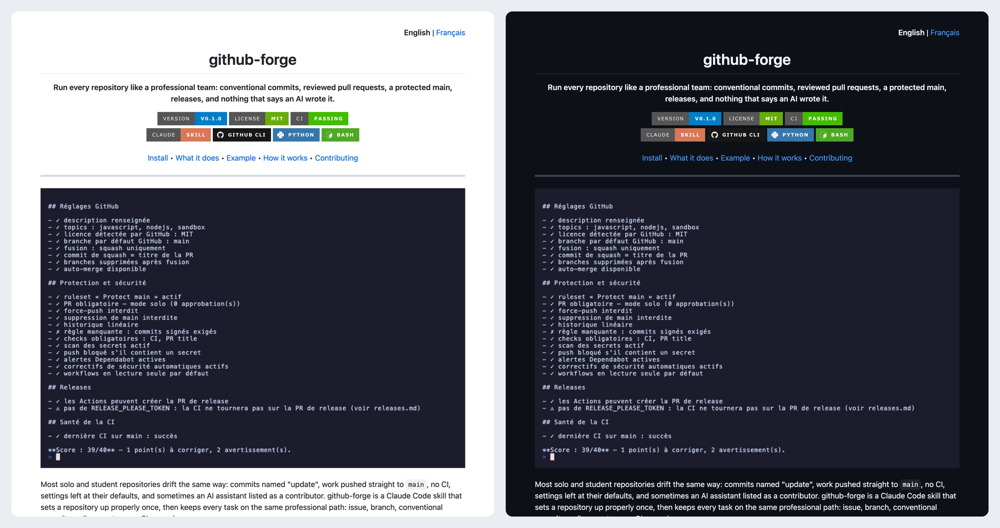

<p align="right"><b>English</b> | <a href="./README.fr.md">Français</a></p>

<h1 align="center">readme-forge</h1>

<p align="center">
  <b>Ask for a README. Get a bilingual one with real screenshots, badges and community files, checked against GitHub's own renderer.</b>
</p>

<p align="center">
  <a href="https://github.com/thmsgo18/readme-forge/releases"></a>
  <a href="LICENSE"></a>
  <a href="https://github.com/thmsgo18/readme-forge/actions/workflows/ci.yml"></a>
  <br>
  
  
  
  
</p>

<p align="center">
  <a href="#install">Install</a> •
  <a href="#what-you-get">What you get</a> •
  <a href="#example">Example</a> •
  <a href="#how-it-works">How it works</a> •
  <a href="#contributing">Contributing</a>
</p>

---

<p align="center">
  
</p>
<p align="center"><sub>The README of <a href="https://github.com/thmsgo18/github-forge">github-forge</a>, written with this skill, as GitHub renders it in light and dark.</sub></p>

A README decides in ten seconds whether someone tries your project. Most are either a single line or a wall of text, with a screenshot from three versions ago. readme-forge is a Claude Code skill that reads your project, runs it, captures it with demo data, and writes the README a visitor actually reads: a one-line promise, badges, a visual right away, then short sections that get them running.

It writes nothing it cannot verify. Every command, number and feature comes from the code or from running the project, and every image is checked before it goes in.

## Install

As a personal skill, available in every project:

```bash
git clone https://github.com/thmsgo18/readme-forge.git ~/.claude/skills/readme-forge
```

Or only for one repository:

```bash
git clone https://github.com/thmsgo18/readme-forge.git .claude/skills/readme-forge
```

Then ask Claude Code, in English or French: "write the README", "fais le README", "audit my README", "update the README".

<details>
<summary>Requirements</summary>

- `python3` for the scripts (standard library only) and `git`.
- The [GitHub CLI](https://cli.github.com/), logged in, for the GitHub preview and the repository metadata.
- For screenshots and videos: Node.js and Google Chrome. `scripts/setup_capture.sh` installs the Playwright driver once, without downloading a browser.
- Optional: [vhs](https://github.com/charmbracelet/vhs) for terminal GIFs, `ffmpeg` for screen recordings, Xcode or the Android SDK for mobile apps.

</details>

## What you get

| File | Contents |
|---|---|
| `README.md` | English, 100 to 200 lines: header, badges, hero visual, quick start, features, how it works |
| `README.fr.md` | The French twin, rewritten in natural French rather than translated, with its own anchors |
| `docs/assets/` | Screenshots, GIFs or diagrams captured from the running project, with demo data |
| `docs/demo/` | The tapes and scenarios that produced them, so they can be regenerated |
| `LICENSE`, `CONTRIBUTING.md`, `SECURITY.md` | MIT license and community files fitted to the project |
| GitHub metadata | A description and topics, applied only once you agree |

The skill adapts to the kind of project: a terminal GIF for a CLI, a row of phone screenshots for a mobile app, the main window for a desktop app, a pipeline diagram and results table for a research project.

## Example

Before writing, the skill audits what exists. The same linter checks its own output at the end. Here it is on a five-line README, word for word:

```text
$ python3 scripts/lint_readme.py .
ERROR   README.md:1: emoji 🚀: replace with words (Yes/No in tables)
ERROR   README.md:3: long dash (— or –): rewrite with a comma, colon, parentheses or two sentences; for ranges write 'to' ('20 to 30 min')
ERROR   README.md:5: missing local file: docs/guide.md
ERROR   README.md:1: no language switch to README.fr.md in the first lines
ERROR   README.md:1: fewer than 2 badges at the top
ERROR   README.fr.md:0: file is missing
ERROR   LICENSE:0: file is missing
warning README.md:3: AI-sounding wording: 'seamless'
warning README.md:3: AI-sounding wording: 'blazing fast'
warning README.md:5: 5 lines, target is 100 to 200
warning README.md:1: no version badge
warning README.md:1: no image at all: add a screenshot, GIF or diagram
README.md: 5 lines

7 error(s), 5 warning(s)
```

Ask for an audit only and you get a score out of 100 on a 30-criterion rubric, with what to fix first, and nothing changed.

## How it works

1. **Understand**: `detect_project.py` reads manifests, languages, git history, CI and GitHub state. Claude reads the code and runs the project.
2. **Plan**: you get the tagline, sections, visuals, badges and topics to approve before anything slow happens.
3. **Capture**: real screenshots and videos with demo data, through Chrome, vhs, the iOS Simulator or the Android emulator.
4. **Write**: both READMEs and the community files, following a style guide that bans emoji, long dashes and the usual generated-text wording.
5. **Verify**: `lint_readme.py` checks every rule, link, anchor and badge; `preview_readme.py` renders both files through GitHub's own Markdown API, in light and dark.
6. **Ask**: commit, push and the GitHub description happen only once you say so.

| Script | What it does |
|---|---|
| `detect_project.py` | Project facts as JSON |
| `lint_readme.py` | Every hard rule, links, anchors, badges, English and French parity |
| `preview_readme.py` | GitHub-accurate render, light and dark, as HTML and PNG |
| `capture_web.cjs` | Web screenshots and scripted demo videos with a visible cursor |
| `make_gif.sh` | Screen recording to an optimized GIF |
| `changes_since_readme.py` | What changed since the README was last updated, and which images may be stale |

## Related

- [github-forge](https://github.com/thmsgo18/github-forge): the skill that sets up and runs the repositories these READMEs live in.

## Contributing

Bug reports and pull requests are welcome, see [CONTRIBUTING.md](CONTRIBUTING.md). Security issues: see [SECURITY.md](SECURITY.md).

## License

[MIT](LICENSE) © Thomas Gourmelen

## Author

Made by [thmsgo18](https://github.com/thmsgo18)
