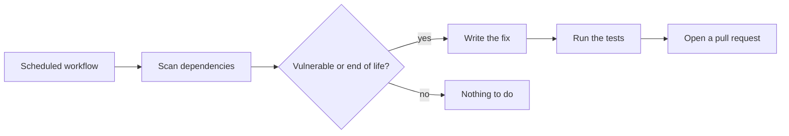

# Visuals

## Contents
1. What to capture
2. Data hygiene and checks
3. Files and folders
4. Terminal and CLI (vhs)
5. Web apps (capture_web.cjs)
6. Desktop apps
7. Mobile apps (iOS Simulator, Android emulator, Flutter)
8. Projects without a UI
9. Videos
10. Size and format
11. Embedding snippets

`S=~/.claude/skills/readme-forge/scripts` below.

## 1. What to capture

Plan one **hero** and two to six **supporting** visuals.

- The hero shows the project's core promise working, end to end, in under 15 seconds of GIF or in one screenshot. For a CLI: the main command and its result. For an app: the main screen with realistic content, or the key flow.
- Supporting visuals each show one distinct feature. If two screenshots would get the same caption, keep one.
- Real content, realistic volume: a list with 6 to 12 plausible items looks alive; an empty state or 200 rows does not.
- Consistent framing: same viewport size, same theme, same zoom across a set.
- Light theme by default (most readable on both GitHub themes). A dark-only app stays dark.

## 2. Data hygiene and checks

- Use demo data: the project's seed or fixture data, or a throwaway copy you fill with plausible fictional entries. Never open the owner's real database, real accounts or personal files for a capture. If the app reads a real data file by default, point it at a temporary copy or a temp folder (environment variable, CLI flag, or a copy of the project).
- Nothing secret or personal on screen: no API keys, tokens, emails, phone numbers, real names of private people, home paths with the username when avoidable (record in `/tmp/...`).
- After each capture, open the image with Read and check: content fully loaded, no error message, no debug banner or dev overlay, no cursor stuck mid-screen in a still, text readable at the size it will be displayed.
- Record what you did in `docs/demo/` (tapes, scenario JSON, a short `README` or comments) so the owner can regenerate the visuals after a UI change.
- Stop every dev server, simulator recording or emulator you started.

## 3. Files and folders

- Default folder `docs/assets/`. If the repo already keeps images elsewhere (`docs/`, `assets/`, `.github/`, `screenshots/`), use that.
- Kebab-case names that say what is shown: `demo-create.gif`, `screenshot-dashboard.png`, `screenshot-dashboard.fr.png`.
- Keep the old image files the new README no longer uses only if something else references them; otherwise list them in the summary and suggest deleting them (do not delete without asking).

## 4. Terminal and CLI (vhs)

`vhs` turns a `.tape` script into a GIF in a real terminal. Keep the tape in `docs/demo/` and add a `record.sh` when there are several.

```tape
# Hero GIF: <what it shows>. Regenerate: vhs docs/demo/create.tape (from the repo root)
Output docs/assets/demo-create.gif

Set FontSize 16
Set Width 1100
Set Height 520
Set Padding 18
Set Theme "Catppuccin Mocha"
Set TypingSpeed 45ms

# Throwaway directory so the recording is reproducible and shows no personal path.
Hide
Type "rm -rf /tmp/demo && mkdir -p /tmp/demo && cd /tmp/demo && clear"
Enter
Show

Type "mytool create --name my-report"
Sleep 600ms
Enter
Sleep 3s

Type "ls my-report"
Enter
Sleep 3s
```

Tips:
- `Require mytool` at the top fails fast if the command is missing.
- Use `Hide` / `Show` around setup and environment variables; the viewer only needs the meaningful commands.
- Keep it under 20 seconds. Let the result stay on screen for 2 to 4 seconds before the end.
- Commands that need a network or an API key: use a recorded or mocked mode if the tool has one, otherwise ask the user.
- Check the GIF size (target under 5 MB). Reduce `Width`/`Height`, `FontSize`, or the length.
- The prompt shown is vhs's own clean prompt, not the user's shell config.

## 5. Web apps (capture_web.cjs)

One-time setup (installs the Playwright driver only, it uses the installed Google Chrome):

```bash
bash $S/setup_capture.sh
```

Start the app the way its README or scripts say (`npm run dev`, `python manage.py runserver`, `docker compose up`...) in the background, wait for the port, and seed demo data. For a full stack app, start the backend and the frontend.

Single screenshot:

```bash
node $S/capture_web.cjs shot --url http://localhost:5173 --out docs/assets/screenshot-home.png --width 1280 --height 800
```

Options: `--scale 2` (default, crisp on retina), `--full-page`, `--dark`, `--wait 1500`, `--selector ".main-panel"` to capture one element.

Scripted flow (several screenshots and/or one video), saved as `docs/demo/scenario.json`:

```json
{
  "baseUrl": "http://localhost:5173",
  "viewport": {"width": 1280, "height": 800},
  "cursor": true,
  "video": "docs/demo/demo.webm",
  "steps": [
    {"goto": "/"},
    {"wait": 800},
    {"screenshot": "docs/assets/screenshot-home.png"},
    {"click": "text=New event"},
    {"type": {"selector": "input[name=title]", "text": "Neuroscience meetup", "delay": 70}},
    {"click": "button[type=submit]"},
    {"waitFor": "text=Event created"},
    {"wait": 1500}
  ]
}
```

```bash
node $S/capture_web.cjs scenario docs/demo/scenario.json
bash $S/make_gif.sh docs/demo/demo.webm docs/assets/demo.gif --width 960 --start 0.5
```

Steps available: `goto`, `wait` (ms), `waitFor` (selector), `click`, `hover`, `type` ({selector, text, delay}), `fill`, `press` (key), `select` ({selector, value}), `scroll` (pixels), `eval` (JS string), `screenshot` (path or {path, selector, fullPage}). Selectors are Playwright selectors (`text=...`, CSS, `>> nth=0`). `"cursor": true` draws a visible pointer that moves smoothly to each click target, which makes a GIF easy to follow. Do not commit the `.webm` unless the user wants it; the GIF is the deliverable.

Logins: use a demo account from the project's seed or fixtures, created for the capture. Never type the owner's real credentials.

The Claude browser pane (`mcp__Claude_Browser__*`) is also fine for exploring the app and taking quick screenshots, but `capture_web.cjs` gives reproducible, consistently sized files.

## 6. Desktop apps

- **Web view over a local server** (pywebview, Flask/FastAPI + window, Electron or Tauri loading a dev server): capture the server URL with `capture_web.cjs` at the window's size. This is how the Azimut screenshots were made, with demo data.
- **Native macOS window**: launch the app, find its window id, capture just that window (with its shadow trimmed by `-o`):

```bash
swift $S/list_windows.swift "AppName"          # prints: id, owner, title, size
screencapture -x -o -l <id> docs/assets/screenshot-main.png
```

  This needs the Screen Recording permission for the app running Claude. If the image is blank or shows only the wallpaper, ask the user to grant it (System Settings, Privacy and Security, Screen Recording) or to take the screenshots.
- **Video of a native app**: `screencapture -v -l <id> out.mov` is interactive; prefer asking the user for a short recording (Cmd+Shift+5) and convert it with `make_gif.sh`. Computer use tools can drive the app if they are available and the user agrees.
- Windows and Linux only apps you cannot run here: ask the user for screenshots.

## 7. Mobile apps

**iOS Simulator** (Flutter, SwiftUI, React Native):

```bash
xcrun simctl list devices available | grep -i iphone
xcrun simctl boot "iPhone 17 Pro"            # pick a recent device that exists
open -a Simulator
xcrun simctl status_bar booted override --time 9:41 --batteryState charged --batteryLevel 100 --cellularBars 4 --wifiBars 3
```

Build and install the app. Flutter only runs debug builds on the iOS Simulator, so check that `MaterialApp` sets `debugShowCheckedModeBanner: false`; if it does not, ask before touching the code (or capture on an Android emulator with `flutter run --profile`, which has no banner). A Flutter debug build runs on the Simulator without the `flutter` tool attached:

```bash
flutter build ios --simulator --debug
xcrun simctl install booted build/ios/iphonesimulator/Runner.app
xcrun simctl launch booted <bundle-id>
```

Drive it with the iOS Simulator tool (`mcp__Claude_Code_iOS_Simulator__control`: tap, swipe, text) when available. Photos the app should find in the gallery: `xcrun simctl addmedia booted photo1.jpg photo2.jpg`. For screenshots in another language (apps that follow the device language), switch the Simulator and relaunch the app:

```bash
xcrun simctl spawn booted defaults write "Apple Global Domain" AppleLanguages -array fr-FR
xcrun simctl spawn booted defaults write "Apple Global Domain" AppleLocale -string fr_FR
xcrun simctl terminate booted <bundle-id>; xcrun simctl launch booted <bundle-id>
```

Then:

```bash
xcrun simctl io booted screenshot docs/assets/screenshot-home.png

# Video: start the recording as a background command, drive the app, then stop it
# with SIGINT (a plain kill leaves an unreadable file).
xcrun simctl io booted recordVideo --codec=h264 --force /tmp/demo.mov
pkill -INT -f "simctl io booted recordVideo"
bash $S/make_gif.sh /tmp/demo.mov docs/assets/demo.gif --width 360 --fps 15

xcrun simctl status_bar booted clear
```

**Android emulator**:

```bash
adb devices
adb shell settings put global sysui_demo_allowed 1
adb shell am broadcast -a com.android.systemui.demo -e command enter
adb shell am broadcast -a com.android.systemui.demo -e command clock -e hhmm 0941
adb exec-out screencap -p > docs/assets/screenshot-home.png
adb shell screenrecord --time-limit 20 /sdcard/demo.mp4 && adb pull /sdcard/demo.mp4 /tmp/demo.mp4
adb shell am broadcast -a com.android.systemui.demo -e command exit
```

Recording tips: run each gesture back to back while recording, without screenshots or checks in between (every pause ends up in the video). Simulator recordings only store frames when the screen changes, so the last state has no hold: use `make_gif.sh --hold 2.5`, and `--start` to cut the idle opening. Check the result by extracting a strip of frames: `ffmpeg -i demo.mov -vf "fps=2,scale=180:-1,tile=12x1" -frames:v 1 strip.png`.

Use a throwaway Simulator so the owner's own devices and their app data stay untouched, and delete it at the end:

```bash
UDID=$(xcrun simctl create "readme-capture" "iPhone 17 Pro" | tail -1)
...
xcrun simctl shutdown "$UDID" && xcrun simctl delete "$UDID"
```

Demo content: when the app has no seed data, fill the throwaway Simulator's app container (`xcrun simctl get_app_container "$UDID" BUNDLE_ID data`) with fictional records while the app is stopped, through the app's own database schema or its backup/import format. Images for fictional records can be drawn with Pillow (simple flat illustrations on a light backdrop read well). Never copy the owner's own Simulator data.

Rules for phone visuals: same device for the whole set, status bar cleaned, demo data, 3 or 4 screens shown side by side at `width="230"`. Phone GIFs: width 300 to 360 px, 12 to 15 fps.

## 8. Projects without a UI

- **Library**: a code example and its real output, captured by running it. Optionally a terminal GIF of the example running.
- **Backend / API**: a Mermaid architecture diagram (GitHub renders ```` ```mermaid ```` blocks natively), an example request and response, and if there is a Swagger or admin page, a screenshot of it.
- **Pipeline, GitHub Action, ML project**: a Mermaid flowchart of the pipeline, plus the real artefact it produces (a PR screenshot, a results plot, a metrics table).
- **Notebooks**: reuse the figures the notebooks already produce. Extract embedded PNG outputs:

```bash
python3 - <<'EOF'
import base64, json, pathlib, sys
out = pathlib.Path("docs/assets"); out.mkdir(parents=True, exist_ok=True)
for nb in pathlib.Path(".").rglob("*.ipynb"):
    cells = json.loads(nb.read_text()).get("cells", [])
    for i, c in enumerate(cells):
        for j, o in enumerate(c.get("outputs", [])):
            png = o.get("data", {}).get("image/png")
            if png:
                (out / f"{nb.stem}-{i}-{j}.png").write_bytes(base64.b64decode(png))
EOF
```

  Then pick the one or two figures that tell the story and delete the rest.
- **Claude skill**: run the skill on a small example to produce real output (a deck, a PDF, a document), then screenshot that output. Show the conversation that produced it as a `text` block.

Mermaid example:

````markdown

````

## 9. Videos

- Existing `https://github.com/user-attachments/assets/...` links and YouTube links from the old README are valuable: keep them, under a "See it in action" section, with the YouTube badge.
- A new MP4 can only become a `user-attachments` embed by uploading it through the GitHub web editor (drag and drop into the README edit box). Tell the user if a recording deserves that; otherwise use a GIF in the repo.
- A polished promo video (music, motion design) is a different job: suggest the owner's `rendu-video` skill instead of doing it here.

## 10. Size and format

- PNG for screenshots. Captured at scale 2, they stay sharp when displayed at `width="800"`. Keep each under about 1.5 MB; shrink with `sips -Z 2000 file.png` (macOS) if needed.
- GIF for motion, via `make_gif.sh`: 10 to 15 fps, 800 to 1000 px wide for desktop, 300 to 360 px for phones, under 5 MB (the linter errors above 8 MB, which GitHub may refuse to display).
- SVG for diagrams and logos only.

## 11. Embedding snippets

Hero:

```html
<p align="center">
  
</p>
```

Two screenshots side by side:

```html
<table>
<tr>
<td width="50%"></td>
<td width="50%"></td>
</tr>
</table>
```

Phone row:

```html
<p align="center">
  
  
  
</p>
```

Extra screenshots without adding length:

```html
<details>
<summary>More screenshots</summary>


</details>
```

Logo that adapts to dark mode:

```html
<picture>
  <source media="(prefers-color-scheme: dark)" srcset="docs/assets/logo-dark.png">
  
</picture>
```
